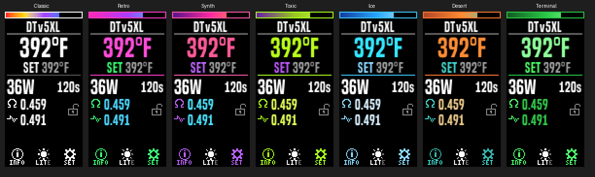

# Gremlin: DNA100C Thelema Solo build + Divine Tribe TCR setup

**Low vision? See the High Contrast theme: [high-contrast/README.md](high-contrast/README.md)**

A Lost Vape Thelema Solo converted to an **Evolv DNA100C**, set up for Divine Tribe heaters (**V5 XL** and **Lightning Quest**) with true TCR, Session Mode, and a custom theme, **Gremlin**.

> **Using AI to customize or troubleshoot?** Start with **[AI-GUIDE.md](AI-GUIDE.md)**: step-by-step instructions for using these docs with Claude, ChatGPT, or similar.
>
> **AI assistant continuing this project?** Read **[kb/00-README.md](kb/00-README.md)** first. It has the current state, conventions, and the file index, and the rest of `kb/` holds the details.

## Contents
- [`AI-GUIDE.md`](AI-GUIDE.md): how to use these docs with an AI assistant
- [`guides/chip-swap-thelema-solo-dna100c.md`](guides/chip-swap-thelema-solo-dna100c.md): chip swap guide (parts, soldering, screen, power-up)
- [`guides/setup-gremlin-theme-profiles-calibration.md`](guides/setup-gremlin-theme-profiles-calibration.md): setup guide — loading the theme, materials, profiles, and calibration
- [`release/`](release/): **`gremlin_v2.2.02_theme.ecigtheme`** (current theme) and **`gremlin_v2.2.02.ecig`** (v2.2 full device config: the theme plus the four Divine Tribe profiles), [`release/RELEASE-NOTES.md`](release/RELEASE-NOTES.md) (what changed in each version), `gremlin_v1.0_theme.ecigtheme` and `gremlin_v1.0.ecig` (v1.0 theme and full device config), `profiles/*.ecigprofile`, `materials/*.csv`
- [`high-contrast/`](high-contrast/): **Gremlin High Contrast - Large Text v1.2**, a separate theme for low vision
- [`kb/`](kb/): detailed technical notes (reverse-engineered theme format, DNA field IDs, design spec, gotchas)
- [`images/`](images/): build photos

## Gremlin - Color Themes v2.2
The current Gremlin theme has seven looks. Pick one under **MENU → THEMES** (turn on one at a time; all off is Classic):

- **Classic:** white and gray on black
- **Retro:** 80s neon green, hot pink, and cyan
- **Synth:** synthwave pink, purple, and a sunset battery bar
- **Toxic:** acid lime and purple
- **Ice:** electric cyan, frost blue, and white
- **Desert:** sunset orange and turquoise
- **Terminal:** green CRT

Themes recolor the home and lock screens and each menu's title. Also new in v2.x: an orange FIRING box while heating, a red LOW BATTERY banner under 15%, and profile-colored accents.

## Requirements
Evolv DNA color chip (DNA75C / DNA100C / DNA250C) with **international firmware (SP55.1 INT+)** for Session Mode. Requires up/select/down buttons plus fire.

**EScribe**, Evolv's free configuration software, is what loads all of this. Download it from Evolv: <https://www.evolvapor.com/escribe>. Install it, connect the mod, and let it update to the **international edition** — pick international, not US. The US edition does not expose Session Mode, and the theme will not upload without it.

## Calibrate before you rely on it
A TCR value is a starting point, not a setting: every mod and every cup reads a little differently. Run the swab test in [the setup guide](guides/setup-gremlin-theme-profiles-calibration.md) before you trust the number on the screen, then **set your working temperature at the low end and climb**. Starting cool costs you one mild session; starting hot scorches the load and shortens cup life.

## Disclaimer
Opening your mod and soldering lithium-battery circuits is at your own risk and voids warranties. Verify polarity and continuity before powering up.
