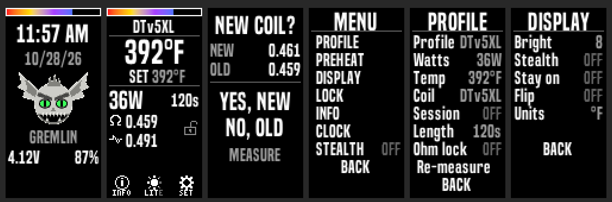

# Gremlin: DNA100C Thelema Solo build + Divine Tribe TCR setup

A Lost Vape Thelema Solo converted to an **Evolv DNA100C**, set up for Divine Tribe heaters (**V5 XL** and **Lightning Quest**) with true TCR, Session Mode, and a custom theme, **Gremlin**.

> **Using AI to customize or troubleshoot?** Start with **[AI-GUIDE.md](AI-GUIDE.md)**: step-by-step instructions for using these docs with Claude, ChatGPT, or similar.

## Contents
- [`AI-GUIDE.md`](AI-GUIDE.md): how to use these docs with an AI assistant
- [`reddit/01-dna100c-thelema-chip-swap.md`](reddit/01-dna100c-thelema-chip-swap.md): chip swap guide (parts, soldering, screen, power-up)
- [`reddit/02-gremlin-theme-and-dt-profiles.md`](reddit/02-gremlin-theme-and-dt-profiles.md): loading the theme, materials, profiles, and calibration
- [`release/`](release/): `gremlin_v1.0_theme.ecigtheme`, `gremlin_v1.0.ecig` (full device config), `profiles/*.ecigprofile`, `materials/*.csv`
- [`kb/`](kb/): detailed technical notes (reverse-engineered theme format, DNA field IDs, design spec, gotchas)
- [`images/`](images/): build photos

## Requirements
Evolv DNA color chip (DNA75C / DNA100C / DNA250C) with **international firmware (SP55.1 INT+)** for Session Mode. Requires up/select/down buttons plus fire.

**EScribe**, Evolv's free configuration software, is what loads all of this. Download it from Evolv: <https://www.evolvapor.com/escribe>. Install it, connect the mod, and let it update to the **international edition** — pick international, not US. The US edition does not expose Session Mode, and the theme will not upload without it.

## Calibrate before you rely on it
A TCR value is a starting point, not a setting: every mod and every cup reads a little differently. Run the swab test in [`reddit/02`](reddit/02-gremlin-theme-and-dt-profiles.md) before you trust the number on the screen, then **set your working temperature at the low end and climb**. Starting cool costs you one mild session; starting hot scorches the load and shortens cup life.

## Disclaimer
Opening your mod and soldering lithium-battery circuits is at your own risk and voids warranties. Verify polarity and continuity before powering up.
