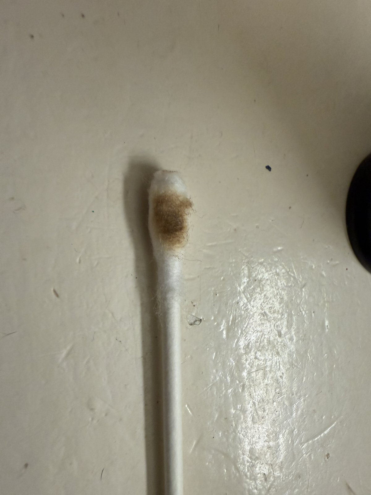
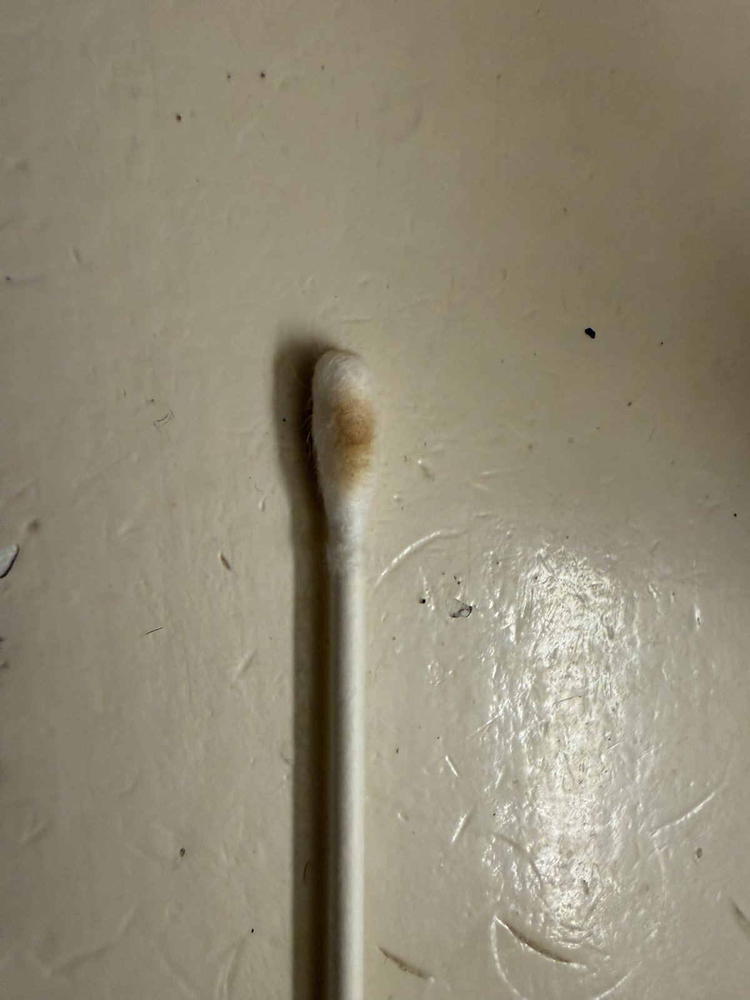
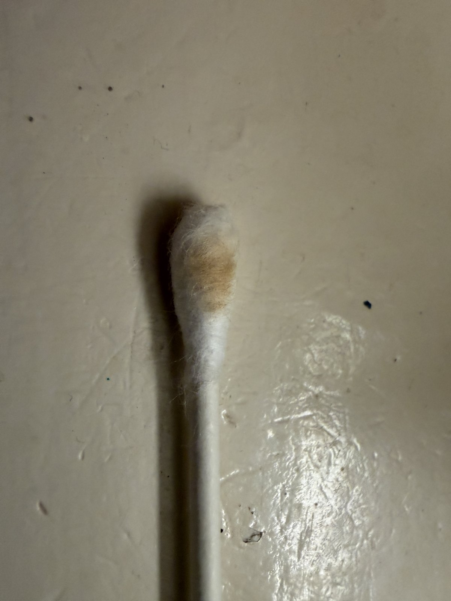

# Setup guide: Gremlin theme, Divine Tribe profiles, and calibration

This is the setup half of my Thelema Solo DNA100C build (**[chip swap guide](chip-swap-thelema-solo-dna100c.md)**). It works on **any DNA color mod** (DNA75C, DNA100C, DNA250C) running Evolv's **international firmware**.

**Low vision? See the High Contrast theme: [../high-contrast/README.md](../high-contrast/README.md)**

**Downloads:** https://github.com/Gerglem/gremlin-dna-theme/tree/main/release
- `gremlin_v2.2_theme.ecigtheme`: the theme
- `materials/dtv5xl-tcr200.csv` and `materials/questcup-tcr120.csv`: the TCR material curves
- `profiles/DTv5XL-Profile.ecigprofile`, `QuestCup.ecigprofile`, `DTv5XL-Clean.ecigprofile`, `QuestCup-Clean.ecigprofile`
- `gremlin_v2.2.ecig`: the full setup — the theme plus the four profiles, with cold resistance cleared so you measure your own

---

## The settings

| Profile | Mode | TCR | Power | Temp | Session |
|---|---|---|---|---|---|
| **DTv5XL** | Temp control | 200 | 36W | 380°F (start here, work up) | 60s |
| **QuestCup** (Lightning Quest) | Temp control | 120 | 25W | 380°F (start here, work up) | 60s |
| **DTv5XL-Clean** | Wattage | — | 38W | — | 120s |
| **QuestCup-Clean** | Wattage | — | 35W | — | 45s |

The temperature in each profile is a starting point, not a recommendation. **Set it low and work up** — see the end of step 4.

Sources:
- **V5 XL:** Divine Tribe's published settings are TCR 200, 36W to reach 500°F. Their burn-off clean is **38W in wattage mode, held upside down, for 2 minutes**, then cool completely.
- **Lightning Quest:** Divine Tribe lists **TCR 125, or 25W in wattage mode**. A swab test on this DNA100C came out tan at 125 and light gold at **120**, so the files here ship **TCR 120** — run your own swab test anyway (step 4). For cleaning, use **35W wattage mode for up to 45 seconds at a time**, stopping if resistance climbs past about **0.60Ω**, then let it cool before another cycle.
- Both curves include a **display fix**: the curve is flattened slightly between 200°F and 220°F so the live temperature readout behaves on DNA boards. Above 220°F it is identical to a straight TCR line, so vaping temperatures are unaffected.

---

## 1. Firmware first

Session Mode (DNA's autofire: one click starts a timed session, one click stops it) needs **Evolv's international firmware (SP55.1 INT or newer)**.

Get **EScribe**, Evolv's free configuration software, from the official page: <https://www.evolvapor.com/escribe>. Install it, connect the mod over USB-C, and accept the update prompt for the **international edition**.

**Pick international, not US.** The US edition doesn't expose Session Mode, and the theme won't upload without it ("No Compatible Firmware"). If you already installed the US edition, re-run the updater and switch.

## 2. Import the materials

1. **Materials** tab → **Import Material** → `dtv5xl-tcr200.csv`.
2. Name it **DTv5XL** and check **Temperature-Sensing**.
3. Push it to **Materials on Device** with the ▶ arrow.
4. Repeat with `questcup-tcr120.csv` as **QuestCup**.
5. Keep the built-in **Watts** material on the device. The cleaning profiles use it.

The TCR value is built into the CSV curve, so there's no separate TCR field to set.

## 3. Load the profiles

1. **General** tab → pick an empty **Profile** tab → **Load Profile…** → pick the file.
2. Check that **Coil Material** shows the right material (DTv5XL, QuestCup, or Watts).
3. For the temp-control profiles, attach the cup **at room temperature**, click **Measure Ohms**, and check **Locked**.
4. **Upload Settings to Device.**

Locking the cold resistance matters. Temperature control works by comparing the live resistance to the cold resistance, so a lock taken on a warm cup makes everything run hot.

## 4. Calibrate with a swab test (do this, every mod reads a little differently)

A published TCR gets you close. The swab test tells you how far off *your* mod and *your* cup actually are. All you need is a cotton swab.

1. **Lock the cold resistance first** (step 3). Calibration is meaningless without it: temperature control works by comparing live resistance against the cold value, so a lock taken on a warm cup skews everything that follows.
2. Set the profile to **470°F**. This is the test temperature, not a vaping temperature — light gold on cotton is roughly 470°F, and cotton doesn't ignite until about 750°F, so you get a readable result with margin.
3. Start a session and **wait until the displayed temperature stops climbing**. Swabbing before it levels off tests the ramp, not the setpoint.
4. Touch the swab to the **floor of the cup** for about **10 seconds** while it fires.
5. Read the swab:
   - **Light gold:** calibrated. Move on to setting your working temperature.
   - **Still white, or barely marked:** running cool. Raise the TCR.
   - **Medium brown:** running hot. Lower the TCR.
   - **Dark brown or black:** running much too hot. Lower the TCR and re-test before you put anything in the cup.
6. If you changed the TCR, you need a **new material curve** — import it as in step 2, re-lock the ohms, and swab again. Move in small steps.

  

*(These were a Lightning cup on a Pico at TCR 110 → 100 → 95. Different mods need different values. On the DNA, the V5 XL hit light gold at TCR 200 on the first try, and the Lightning Quest took one step: tan at 125, light gold at 120.)*

To change the TCR on a DNA, you need a new material curve. The CSV format is documented in the repo, along with the formula for generating one at any TCR value.

### Then set your working temperature low and climb

Once the TCR is right, don't jump to the top of the range. **Start around 380°F and work up a few degrees at a time** across sessions until you find where you like it.

Vapor comes off much lower than people expect — terpenes and THC volatilize below 350°F, so 380°F already gives you a usable draw. Climbing from cool costs you one mild session. Starting hot scorches the load, and sustained heat above roughly 500°F is one of the main things that kills a cup.

## 5. Load the theme

**Theme** tab → load `gremlin_v2.2_theme.ecigtheme` → **Upload Settings to Device.**

### What Gremlin does
- **Seven looks:** Classic, Retro, Synth, Toxic, Ice, Desert and Terminal, picked under **MENU → THEMES** (turn on one at a time; all off is Classic). They recolor the home screen, the lock screen, and each menu's title.
- **Home screen:** battery bar (green → red as it drains), profile, big **live temperature**, set temperature, watts, **session length**, cold and live resistance, ohm-lock toggle, and a status line that shows the chip's "Firing," "No Atomizer," and other warnings. A **profile-colored accent line** picks up the active theme.
- **While firing:** an orange **FIRING** box.
- **Low battery:** a red **LOW BATTERY** banner below 15%.
- **Edit in place:** use **up/down** to move between editable items (profile, set temp, watts, session time, ohm lock, brightness, menus). **Select** edits the highlighted item. Read-only values are skipped.
- **New coil:** swap a heater with the ohm lock off and the mod asks **NEW COIL?**. Accepting stores the new cold resistance but does **not** lock it, so the screen also carries a **LOCK?** toggle.
- **Fire:** fires from the home screen. On menu pages, it's a **back button**.
- **Menus:** Profile, Preheat, Display, Lock, Info, Clock, and a one-click **Stealth** toggle.
- **Lock screen:** clock, date, a gremlin, and battery.
- Font is Evolv's own Built SemiBold, on black.

### Known limits (firmware, not fixable in a theme)
- The **first fire after power-on** may show a blank status line. That's the chip clearing its own message.
- No "at temperature" indicator: the firmware field for it isn't supported on the DNA100C.
- No live session countdown: Evolv's Theme Designer crashes when you try to display the puff timer field.

---

## Battery tip

In EScribe → **Mod → Battery**, consider raising **Cell Soft Cutoff** to about **3.0V** and lowering **Max USB Charge Rate** to **1.5–2A**. Both are easier on your cells.

Questions or problems? Open an issue on this repository.

**Want to customize it?** The repo's `kb/` folder documents the theme format, DNA field IDs, and everything learned building this, written so you can hand it to an AI assistant (Claude, ChatGPT) and have it make changes for you. See `AI-GUIDE.md` in the repo.
