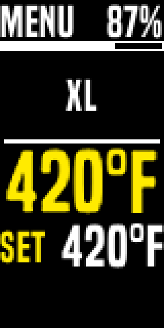
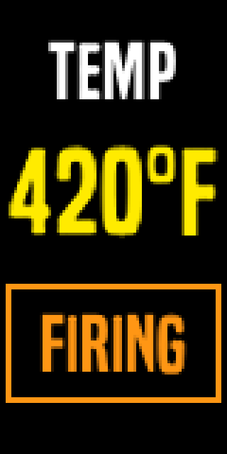
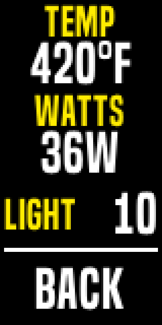
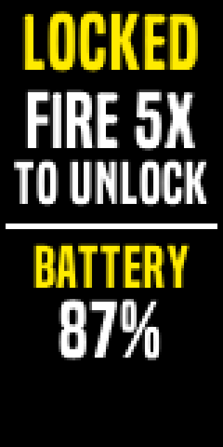
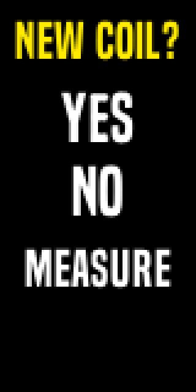

# Gremlin High Contrast: Large Text Theme (v1.2)

A theme for Evolv DNA vape mods, made for people with low vision.

It uses large text, high contrast (white and yellow on black), and very few items on each screen.

This page explains what each file does, how to install it, and how to use the theme.

## Contents

1. What you need
2. Which file should I download?
3. How to download a file from this page
4. How to install the files
5. What each screen shows
6. Using the buttons
7. Changing your settings
8. If the screen says LOCKED
9. Tips
10. Getting help

## 1. What you need

- A mod with an **Evolv DNA color chip**: DNA75C, DNA100C, or DNA250C.
- The chip must run Evolv's **international firmware**, not the US version. This theme does not work on the US version.
- A computer (Windows or Mac) with Evolv's free **EScribe** software.
  - Download EScribe from Evolv's website: https://www.evolvapor.com/escribe
- A USB cable to connect your mod to the computer.

## 2. Which file should I download?

There are three kinds of files. You only need one of the first two.

### Option A: The full setup file (easiest)

- File: [gremlin_high_contrast_v1.2.06.ecig](files/gremlin_high_contrast_v1.2.06.ecig)
- What it contains: the theme **and** four ready-made profiles, all in one file.
- Choose this if you use Divine Tribe V5 XL cups or the Lightning Quest, and you want everything set up at once.
- Note: this replaces all the settings on your mod.

### Option B: The theme only

- File: [gremlin_high_contrast_v1.2.06_theme.ecigtheme](files/gremlin_high_contrast_v1.2.06_theme.ecigtheme)
- What it contains: only the screens, colors, and text size.
- Choose this if you want to keep your own profiles and settings. Only the look of the screen changes.

### Option C: Single profiles (optional)

A profile stores the settings for one heater: power, temperature, and session time. You can add any of these to your mod one at a time.

- [High-Contrast-Profile-V5XL-Cup.ecigprofile](files/profiles/High-Contrast-Profile-V5XL-Cup.ecigprofile)
  - Name on screen: **XL**
  - For: Divine Tribe V5 XL cups.
  - Settings: temperature control, 380°F, 36 watts, 60-second sessions.
- [High-Contrast-Profile-Lightning-Quest.ecigprofile](files/profiles/High-Contrast-Profile-Lightning-Quest.ecigprofile)
  - Name on screen: **QUEST**
  - For: the Divine Tribe Lightning Quest heater.
  - Settings: temperature control, 380°F, 25 watts, 60-second sessions.
- [High-Contrast-Profile-V5XL-Cleaning.ecigprofile](files/profiles/High-Contrast-Profile-V5XL-Cleaning.ecigprofile)
  - Name on screen: **XL CLEAN**
  - For: burning residue off a V5 XL cup.
  - Settings: 38 watts for 120 seconds. Hold the mod upside down. Let the cup cool completely afterward.
- [High-Contrast-Profile-Lightning-Quest-Cleaning.ecigprofile](files/profiles/High-Contrast-Profile-Lightning-Quest-Cleaning.ecigprofile)
  - Name on screen: **Q CLEAN**
  - For: burning residue off a Lightning Quest.
  - Settings: 35 watts for up to 45 seconds. Let it cool completely before running it again.

The temperature profiles also need a **material file**. The material file tells the mod how to read the heater's temperature.

- [dtv5xl-tcr200.csv](files/materials/dtv5xl-tcr200.csv): for the XL profile.
- [questcup-tcr120.csv](files/materials/questcup-tcr120.csv): for the QUEST profile.

## 3. How to download a file from this page

1. Select the file name to open its page.
2. Select the **Download raw file** button. On most screens it is near the top right of the file view.
3. Save the file somewhere easy to find, such as your Desktop.

If you use a screen reader, the button is labeled "Download raw file."

## 4. How to install the files

Before you start, connect your mod to your computer with the USB cable and open EScribe. EScribe should say your device is connected.

### To install the full setup file

1. In EScribe, open the **File** menu and choose **Open**.
2. Choose **gremlin_high_contrast_v1.2.06.ecig**.
3. Select **Upload Settings to Device**.
4. Follow step 4 under "To add a single profile" to lock each cup's resistance.

### To install the theme only

1. Select the **Theme** tab.
2. Load **gremlin_high_contrast_v1.2.06_theme.ecigtheme**.
3. Select **Upload Settings to Device**.

### To add a single profile

1. Select the **Materials** tab. Select **Import Material** and choose the matching material file:
   - **dtv5xl-tcr200.csv** for XL.
   - **questcup-tcr120.csv** for QUEST.
   - The cleaning profiles do not need a material file.
2. Make sure the material appears under **Materials on Device**. If it does not, select it and press the arrow button to move it there.
3. Select the **General** tab, choose an empty profile slot, select **Load Profile**, and choose the profile file.
4. Attach your heater while it is **cold**, at room temperature. Select **Measure Ohms**, then check **Locked**.
5. Select **Upload Settings to Device**.

Step 4 matters. The mod uses the cold reading to work out the temperature. A reading taken on a warm heater makes the mod run too hot.

## 5. What each screen shows

### Home screen

From top to bottom:

1. **MENU** on the left, and the **battery percentage** on the right.
   - Below 15 percent, the percentage and the battery bar turn **red**.
2. A **battery bar**.
3. The **profile name**, for example XL. Long names use two lines.
4. The **current temperature**, in very large yellow numbers.
5. **SET** and your **set temperature**. This item is selected when the mod wakes up, so you can adjust it right away.
6. A **status line** for warnings, such as "No Atomizer" or "Battery Low."

### While firing

When the mod is heating, the whole screen changes to show only:

- **TEMP** and the current temperature, very large.
- **FIRING**, in an orange box.

When heating stops, the home screen returns.

### Menu

- **TEMP**: your set temperature.
- **WATTS**: the power limit.
- **LIGHT**: screen brightness, from 1 to 10. Set it to 10 for the brightest screen.
- **Ω OHMS**: opens the ohms screen, where you read and lock the heater's resistance.
- **BACK**: returns to the home screen.

### Ohms

Choose **Ω OHMS** in the menu to open this screen. It is where you check that the mod has measured your heater correctly.

- **LOCKED**: the resistance the mod has stored for this heater, in ohms. This is the number the temperature control works from, so it needs to be right.
- **LOCK**: the resistance lock. A **solid padlock** means locked, an **open padlock** means unlocked. Lock it once the number above looks right.
- **MEASURE**: reads the heater again and updates the number. Use it with the lock off, when the mod is cold.
- **BACK**: returns to the menu.

A fresh Divine Tribe **V5 XL** cup reads **0.44 to 0.49 ohms** cold. The Lightning Quest has not been measured here, so there is no published figure for it yet. If a cup reads 0, or far outside its usual range, the heater is not making proper contact — unscrew it and put it back on before you lock anything.

**Watch this number over the life of the cup.** A cup on its way out reads higher than it used to: one V5 XL went from 0.43 to 0.61 ohms over two weeks and had to be replaced, with nothing wrong with the base. A steady climb well above the fresh range means order a replacement.

**The number turns red when the cup is due for replacement** — above **0.60 ohms** for the V5 XL, above **0.41 ohms** for the Lightning Quest. Red on the new coil screen means the cup you just fitted is already worn; red on this screen means the one you are using is on its way out. It still works while it is red, so finish the cup if you like, but order another.

### Lock screen

When the mod is locked, the screen says **LOCKED** and tells you how to unlock it: **press the fire button 5 times quickly.** It also shows the battery percentage.

### New coil screen

This screen appears if you attach a different heater while the resistance lock is off.

- **YES**: this is a new heater.
- **NO**: this is the same heater. NO is selected by default, for safety.
- The **number under the question** is the resistance the mod just measured, in ohms. Check it looks right before you answer — see the ohms screen below for what to expect.
- **LOCK?**: the resistance lock. Answering YES stores the new reading but leaves the lock off, so this is here to turn it on without going to the menu. **Answer the question first** — YES for a new heater, NO to keep the one you had. This row only appears once the mod has a resistance stored for the heater, so the first time you set a mod up it will not be there until you answer. That is on purpose: the lock holds the stored resistance, and before you answer there is nothing to hold. If the screen closes when you answer, lock it from **MENU → Ω OHMS** instead.

If you leave the lock on, this screen does not appear at all when you change heaters. Unlock it first, swap the heater, then lock it again.

## 6. Using the buttons

The mod has four buttons:

- **Fire** (the large top button): starts heating. Press it again to stop. In the menu, it goes back.
- **Up** (top of the three small buttons): moves the selection up.
- **Select** (middle small button): selects or edits the highlighted item.
- **Down** (bottom small button): moves the selection down.

The selected item has a **solid yellow bar** with black text.

To change a value:

1. Use **Up** or **Down** to highlight it.
2. Press **Select**. The bar turns **white**. You are now editing.
3. Use **Up** or **Down** to change the value.
4. Press **Select** again to save.

## 7. Changing your settings

### On the mod

- **Set temperature**: on the home screen, or in the menu under TEMP.
- **Profile**: on the home screen, highlight the profile name and press Select. Then use Up or Down to switch.
- **Power and brightness**: in the menu.

### In EScribe, on your computer

Everything else uses standard settings. You can change these in EScribe:

- **Session length**: General tab, Session Mode, Time.
- **Battery cutoff**: Mod tab, Battery. We suggest 3.0 volts.
- **Profile names**: General tab, Name.
- **Auto-lock and the unlock button sequence.**
- **Clock settings.**

## 8. If the screen says LOCKED

The mod locks itself so it can't fire by accident.

- **To unlock:** press the **fire button 5 times quickly**.
- **To lock it yourself:** press the fire button 5 times quickly.
- **Auto-lock:** the full setup file turns auto-lock **off**, so the mod only locks when you lock it. If you installed the theme only, your mod may still lock itself after a few minutes of not being used. To turn that off, open EScribe, find the lock settings, and set Auto Lock to off. Then select Upload Settings to Device.

## 9. Tips

- **Keep profile names short.** About 8 letters fit on one line, and longer names use two lines. Examples: XL, QUEST, XL CLEAN.
- **Turn brightness up to 10** in the menu for the clearest screen.
- **No Atomizer** means the mod cannot detect the heater. Check that the heater is screwed on fully.
- **Firing with no heater attached is safe.** The mod sends no power. The status line shows "No Atomizer."
- **Back up first.** Before uploading anything new, save your current setup in EScribe with File, then Save.

## 10. Getting help

For questions or problems, open an issue on this project's GitHub page.

What changed in each version: [RELEASE-NOTES.md](RELEASE-NOTES.md).

For setup, materials, and calibration details, see the main Gremlin guides: [chip swap](../guides/chip-swap-thelema-solo-dna100c.md) and [setup and calibration](../guides/setup-gremlin-theme-profiles-calibration.md).

The theme is free to use and share.
